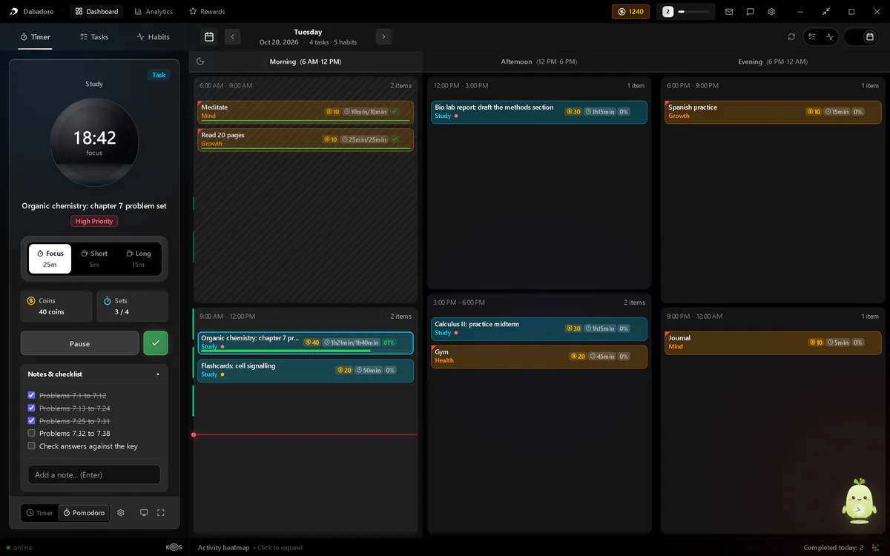
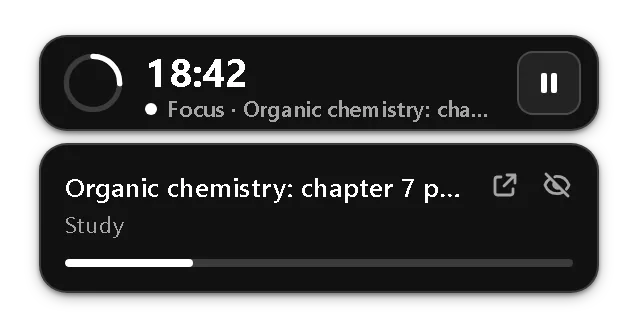
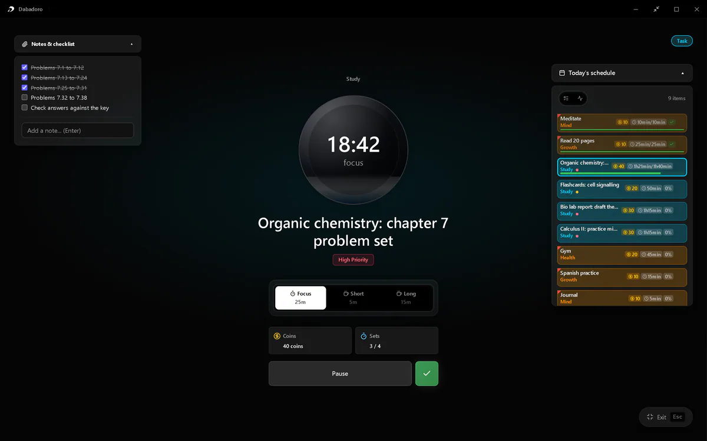
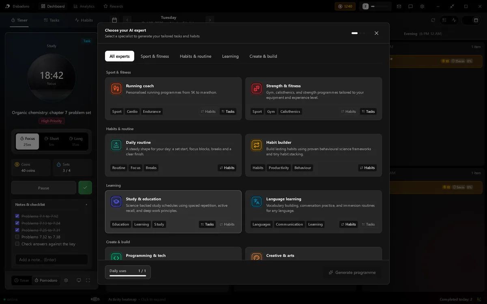
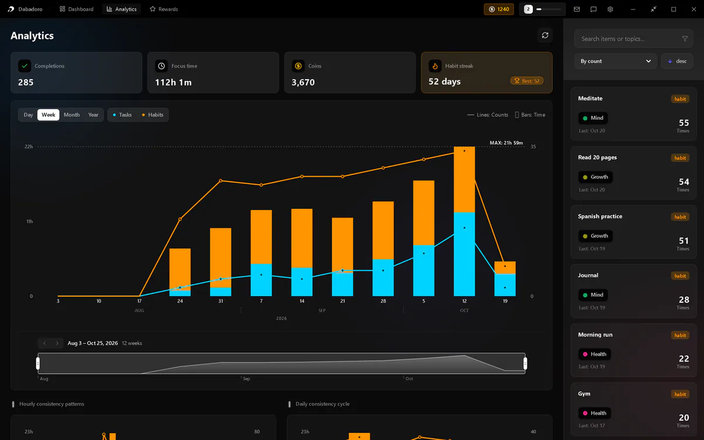
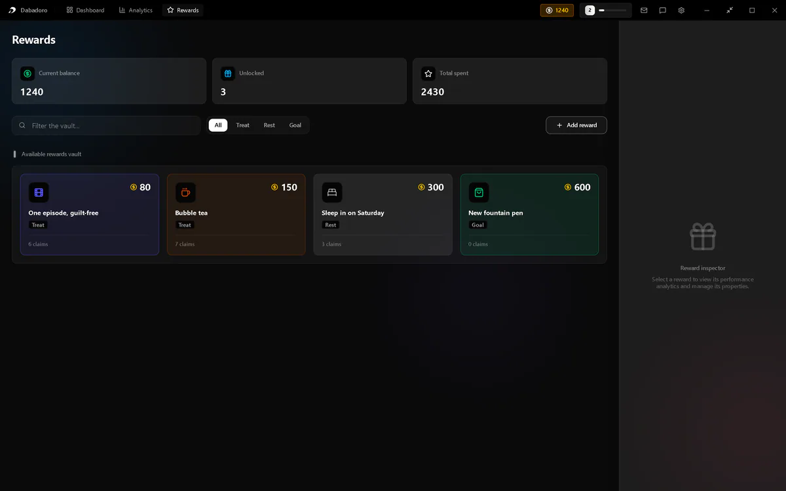

  

<h1 align="center">Dabadoro</h1>

<b>Plan your day, focus on one thing, and build habits that stick.</b>

  <a href="https://github.com/achortex/Dabadoro-Planner/releases/latest"><b>Download</b></a> ·
  <a href="https://dabadoro.com">Website</a> ·
  <a href="https://dabadoro.com/docs/getting-started/">Guides</a> ·
  <a href="https://x.com/dabadoroapp">X</a> ·
  <a href="https://www.instagram.com/dabadoroapp/">Instagram</a>

Dabadoro is a fast, free planner for your computer. Your tasks, habits, schedule and focus timer live in one calm window, and finished work earns coins for rewards you choose yourself.

  <picture>
    <source media="(prefers-color-scheme: dark)" srcset="assets/dashboard-pomodoro-timer-day-planner-dark.webp">
    <source media="(prefers-color-scheme: light)" srcset="assets/dashboard-pomodoro-timer-day-planner-light.webp">
    
  </picture>

## What's new in 1.2

- A floating timer that stays on top of your other windows.
- A new dashboard with the timer, schedule, tasks and habits side by side.
- New schedule views: one day, one period, or a week strip.
- Settings are redesigned, with search to find any setting fast.
- Analytics can group by week, and you drag to pick dates.
- A Messages window with our news and replies to your feedback.
- AI planning has a new Daily routine expert.

[Every release](https://dabadoro.com/changelog/)

## Download

Get it from the [latest release](https://github.com/achortex/Dabadoro-Planner/releases/latest) or [dabadoro.com](https://dabadoro.com/download/). It's free, with a free account.

- **Windows:** the `.exe` installer, for 64-bit Windows.
- **Mac:** the `.dmg` for your Mac, `aarch64` for Apple chips or `x64` for Intel. Needs macOS 11 or later.
- **Linux:** the `.AppImage`, `.deb` or `.rpm`, for 64-bit Linux.

Already have Dabadoro? It tells you when a new version is out, and installs it when you choose.

> **Opening it on a Mac:** the Mac version isn't signed by Apple yet, so macOS may warn you the first time. Open the app once, then choose **Open Anyway** in System Settings, Privacy & Security. You only do this once.

## What it does

### Focus, even in other apps

A Pomodoro timer with your notes and checklist beside it, a full-screen focus mode, and a floating timer that stays on top while you work somewhere else.

  <picture>
    <source media="(prefers-color-scheme: dark)" srcset="assets/floating-timer-expanded-dark.webp">
    <source media="(prefers-color-scheme: light)" srcset="assets/floating-timer-expanded-light.webp">
    
  </picture>

  <picture>
    <source media="(prefers-color-scheme: dark)" srcset="assets/fullscreen-focus-mode-dark.webp">
    <source media="(prefers-color-scheme: light)" srcset="assets/fullscreen-focus-mode-light.webp">
    
  </picture>

### Plan with AI

Pick an expert, answer a few questions, and get a ready plan of tasks and habits for your goal.

  <picture>
    <source media="(prefers-color-scheme: dark)" srcset="assets/ai-command-centre-expert-picker-dark.webp">
    <source media="(prefers-color-scheme: light)" srcset="assets/ai-command-centre-expert-picker-light.webp">
    
  </picture>

### See where your time goes

Analytics by day, week, month or year: what you finished, the time you put in, and your habit streaks.

  <picture>
    <source media="(prefers-color-scheme: dark)" srcset="assets/analytics-week-grouping-dark.webp">
    <source media="(prefers-color-scheme: light)" srcset="assets/analytics-week-grouping-light.webp">
    
  </picture>

### Earn coins, claim rewards

Finished tasks and habits earn coins. Spend them on rewards you set yourself, from a bubble tea to a lie-in.

  <picture>
    <source media="(prefers-color-scheme: dark)" srcset="assets/rewards-vault-dark.webp">
    <source media="(prefers-color-scheme: light)" srcset="assets/rewards-vault-light.webp">
    
  </picture>

## Your data

We don't sell your data, and we don't use it to train AI models. Read the [privacy policy](https://dabadoro.com/privacy/).

## Help

Found a problem or have an idea? Use the feedback button in the app's title bar, or read the [guides](https://dabadoro.com/docs/).

---

Made by one developer at <a href="https://kosmorph.com/">Kosmorph</a>. Free to use; the code is not open source (see <a href="LICENSE">LICENSE</a>).

